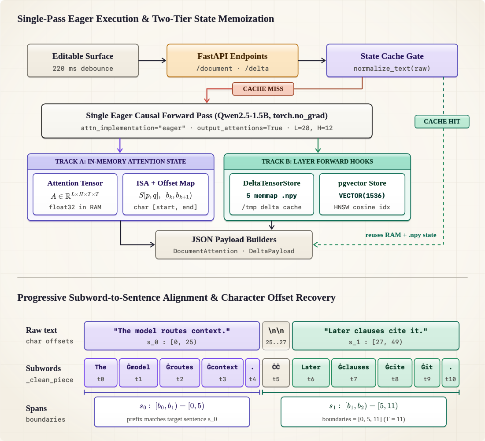
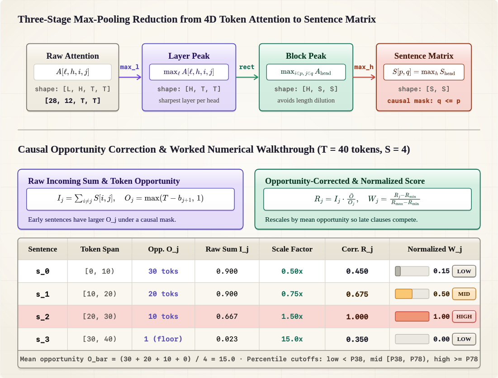
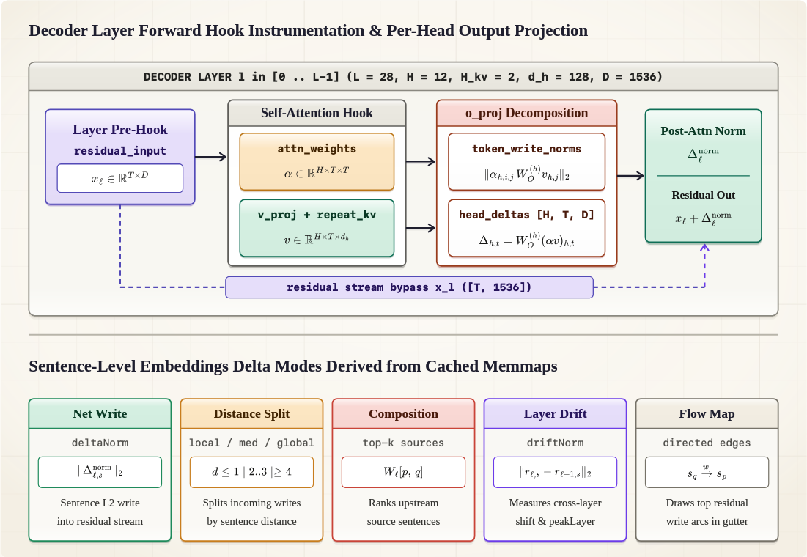
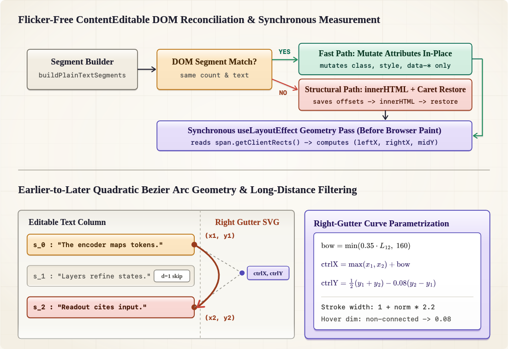
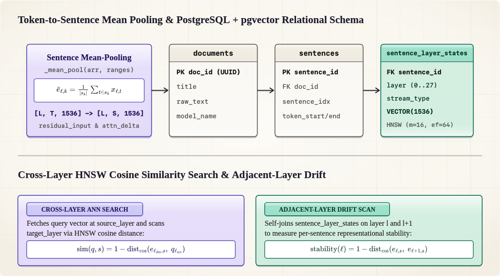

# Attention-Locator

**Attention-Locator** inspects how a causal language model routes attention across sentences and tokens, how earlier sentences influence later ones, and how each transformer layer writes updates into the residual stream.

---

## How the Process Works

### Tokenization & Single Full-Context Pass

The backend takes the raw text (normalizing only line endings to `\n`) and passes the entire document to the model's tokenizer and forward pass in one go with `output_attentions=True` (no sliding windows or chunking).

For a document with `T` subword tokens across `L` transformer layers and `H` attention heads per layer, the model produces a causal self-attention tensor of shape:

```text
A[l, h, i, j]   (shape: L x H x T x T)
```

where:
- `i` is the query token index (the token doing the looking)
- `j` is the key token index (the token being looked at)
- because the model is causal, `j <= i` (later tokens attend back to earlier tokens, never forward to future tokens)

---

### Aligning Subword Tokens to Sentences

Model tokens are subword pieces, not sentences. To map between the two (`backend/attention.py`):

1. The analyzer walks through the token sequence and progressively decodes tokens back into text at newline boundaries and at the end of the sequence.
2. It segments the decoded text into sentences using `nltk` sentence tokenization (with `PunktSentenceTokenizer` fallback).
3. It advances token-by-token until the decoded slice covers each detected sentence and records the exact token boundary indices `sentence_boundaries_ids`.
4. It then maps each sentence string back onto the raw document string (`map_sentences_to_source_offsets`) by matching normalized characters and tracking original character indices.

Every sentence `k` gets two exact spans:
- **Token span**: `tokens[b_k : b_{k+1}]` for slicing model tensors
- **Character span**: `[sourceStart, sourceEnd]` for highlighting the exact slice of text in the UI

| Single-Pass Execution & Alignment | Max-Pooling & Opportunity Correction |
| :---: | :---: |
|  |  |

---

### Building the Sentence-to-Sentence Attention Matrix

To measure how strongly a later sentence `p` attends to an earlier sentence `q`, the analyzer looks at all token pairs `(i, j)` where query token `i` is in sentence `p` and key token `j` is in sentence `q`, and reduces the 4D attention tensor with three max-pooling steps:

```text
1. Max over layers:      A_head[h, i, j] = max_l A[l, h, i, j]
2. Max over token pairs: S_head[h, p, q] = max_{i in p, j in q} A_head[h, i, j]
3. Max over heads:       S[p, q]         = max_h S_head[h, p, q]
```

Using max-pooling instead of averaging preserves strong, targeted links fired by individual specialized heads that would otherwise be washed out when averaged across dozens of inactive heads and layers.

---

### Opportunity-Corrected Sentence Scoring

To compute an overall emphasis score for sentence `j`, we start with the incoming inter-sentence attention it receives from all other sentences in the document (summing column `j` of `S` and removing self-attention on the diagonal):

```text
I_j = sum_i S[i, j] - S[j, j]
```

In a causal model, stopping at `I_j` creates a strong positional bias toward the start of the document: sentence `0` can be attended to by every subsequent token in the document, while a sentence near the end only has a handful of tokens after it.

To correct for this (`compute_opportunity_corrected_sentence_scores` in `backend/analysis.py`), we count how many later tokens `O_j` actually existed after sentence `j` ended (`b_{j+1}`) and therefore had the opportunity to attend to it:

```text
O_j   = max(T - b_{j+1}, 1)
O_bar = max((1 / n) * sum_j O_j, 1)
R_j   = I_j * (O_bar / O_j)
```

where `T` is the total usable token count and `O_bar` is the average opportunity count across all `n` sentences in the document.
- Early sentences with more than average opportunity are scaled down.
- Late sentences with fewer later tokens are scaled up.
- Finally, `R_j` is min-max normalized into `W_j` in `[0, 1]` and grouped into document-relative percentile bands (`low`, `medium`, `high`).

---

### Capturing Residual Stream Deltas (`Embeddings Delta`)

Attention weights `A[l, h, i, j]` show where a head looks, but not how much vector mass it actually writes into the residual stream.

When `Embeddings Delta` is active (`capture_delta_document` in `backend/analysis.py` and `backend/delta_visualization.py`), PyTorch forward hooks intercept every decoder layer `l` during the forward pass:

- **`residual_inputs` (`[L, T, hidden_size]`)**: Hidden state entering each layer.
- **`value_states` (`[L, H, T, head_dim]`)**: Per-head value vectors `V` (with GQA key-value heads repeated to match query heads).
- **`projected_value_states` (`[L, H, T, hidden_size]`)**: Value vectors projected through each head's slice of `o_proj.weight` via `torch.einsum("bhtd,hod->bhto", ...)`, measuring what each source token offers to write into the residual space.
- **`head_projected_delta` (`[L, T, H, hidden_size]`)**: The attention-weighted output of each head projected into the residual space.
- **`attention_delta_post_norm` (`[L, T, hidden_size]`)**: The full layer attention delta after `post_attention_layernorm`.
- **`residual_after_attention` (`[L, T, hidden_size]`)**: `residual_input + attention_delta_post_norm`.

These tensors are stored as memory-mapped `.npy` files via `DeltaTensorStore` (`backend/delta_capture.py`) and aggregated into four sentence-level inspection modes:
- **Local vs global**: Breaks down whether incoming residual writes to each sentence come from nearby, mid-range, or distant earlier sentences (`localShare`, `mediumShare`, `globalShare`).
- **Flow map**: Draws the strongest sentence-to-sentence residual write paths across the document (`globalTopEdges`).
- **Source composition**: Shows which specific earlier sentences write the largest vector contributions into a selected sentence (`topSources`).
- **Layer drift**: Measures how strongly each sentence's representation shifts across layers (`driftNorm` and `peakLayer`).

| Layer Hooks & Delta Decomposition | Surface Reconciliation & Arc Parametrization |
| :---: | :---: |
|  |  |

---

## Interface Views

- **Semantic Surface**: Colors sentences by their opportunity-corrected score `W_j` and draws directional earlier-to-later Bezier arcs (`Pair select`, `Top-k from sentence`, `Global top-k`, and a **Long distance relationship factor** slider that filters out short-range links where `targetIndex - sourceIndex <= factor`).
- **Embeddings Delta**: Colors sentences and draws directional arcs from the captured residual stream writes (`Local vs global`, `Flow map`, `Source composition`, and `Layer drift`).
- **Sentence View**: Interactive `N x N` heatmap of the directional sentence matrix `S[p, q]`. Clicking any cell opens `Token View` for that sentence pair.
- **Token View**: Token-by-token heatmap showing `max_{l, h} A[l, h, i, j]` between the tokens of the two selected sentences.

For a deeper step-by-step walkthrough of the math, tensor shapes, and database queries, see `PipelineFlow.md`.

---

## Project Structure

```text
.
├── backend/
│   ├── main.py                 # FastAPI endpoints and lifespan management
│   ├── attention.py            # Model loader, causal forward pass, and sentence-token alignment
│   ├── analysis.py             # Opportunity-corrected scoring, caching, and PyTorch delta hooks
│   ├── delta_capture.py        # Memory-mapped per-layer tensor store (.npy)
│   ├── delta_visualization.py  # Residual write aggregation and layer drift metrics
│   ├── vector_store.py         # Optional PostgreSQL + pgvector ingestion and search
│   ├── db.py                   # Asyncpg connection pool with pgvector codec
│   └── schema.sql              # Relational + HNSW vector schema
└── frontend/
    ├── render.tsx              # Plain-text surface, in-place span updates, and SVG Bezier arcs
    ├── render.css              # Surface, sentence pill, and arc styles
    └── src/
        ├── App.tsx             # Header tabs, arc/delta controls, and API state
        └── AttentionExplorer.tsx # Sentence and token heatmap matrices
```

---

## Setup & Running

### Backend

Create a virtual environment and install the dependencies:

```bash
python3 -m venv .venv
source .venv/bin/activate
pip install -r backend/requirements.txt
```

If a `.gguf` model is placed in `./model/`, the backend discovers and loads it automatically; otherwise it falls back to `Qwen/Qwen2.5-1.5B-Instruct`.

Start the FastAPI server:

```bash
.venv/bin/uvicorn backend.main:app --reload --port 8000
```

### Frontend

In a second terminal, install dependencies and start the Vite dev server:

```bash
cd frontend
npm install
npm run dev
```

Open `http://localhost:5173`.

---

### Optional PostgreSQL + `pgvector` Store

The attention and delta visualizations work out of the box without a database. To persist sentence-level residual vectors across documents and run cross-layer similarity or drift queries (`/vectors/*`), initialize a PostgreSQL database with `pgvector`:



```bash
psql -U <db_user> -d <db_name> -f backend/schema.sql
```

Set the database environment variables before starting the backend:

```bash
export ATTN_DB_HOST=localhost
export ATTN_DB_PORT=5432
export ATTN_DB_NAME=<db_name>
export ATTN_DB_USER=<db_user>
export ATTN_DB_PASSWORD=<db_password>
```

---

## Running Tests

**Backend:**
```bash
.venv/bin/python -m unittest discover -s backend/tests
```

**Frontend:**
```bash
cd frontend
npm test -- --run
npm run build
```
